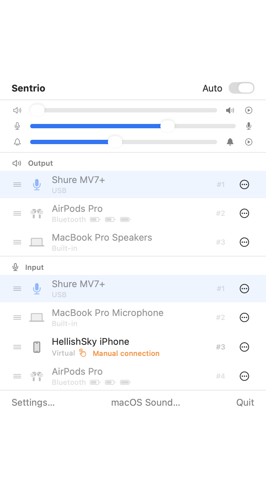
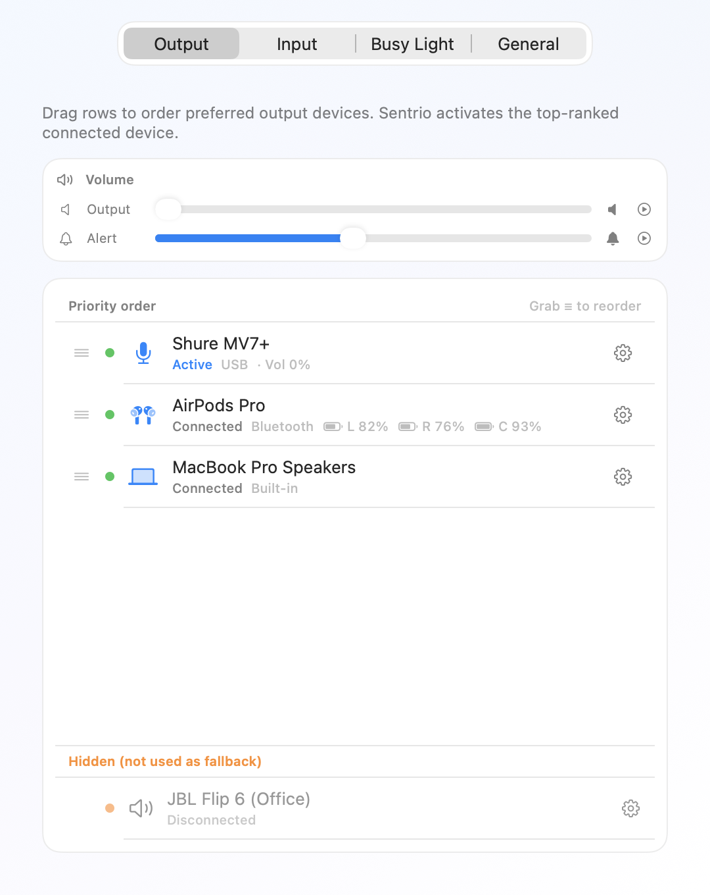
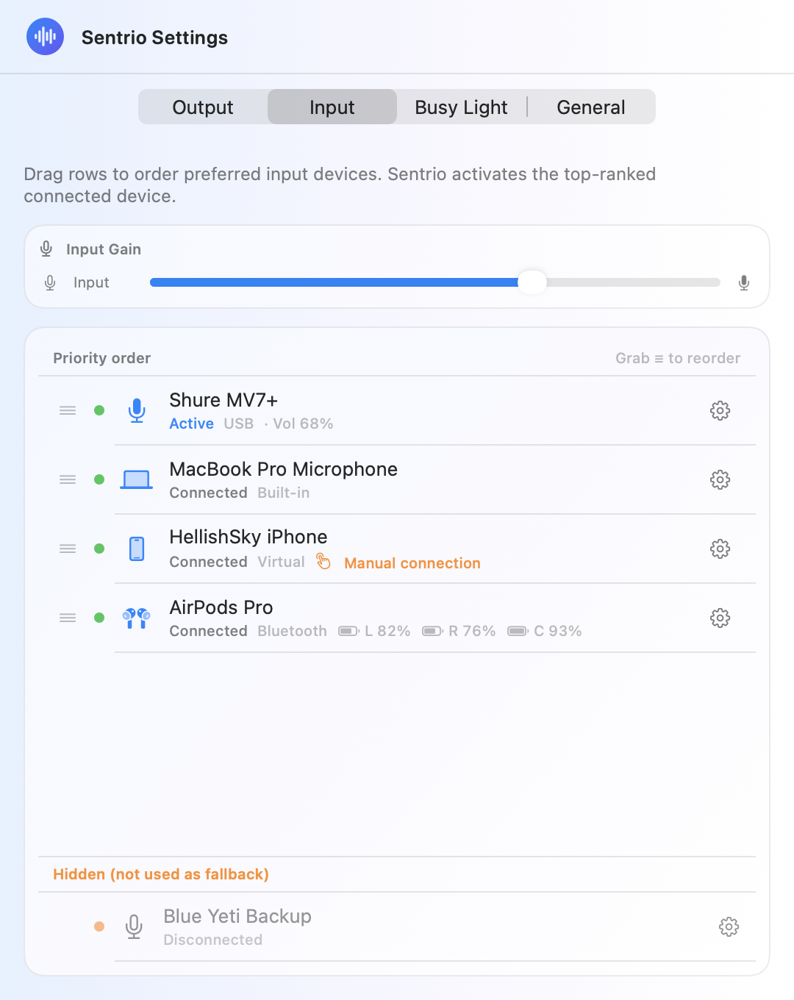
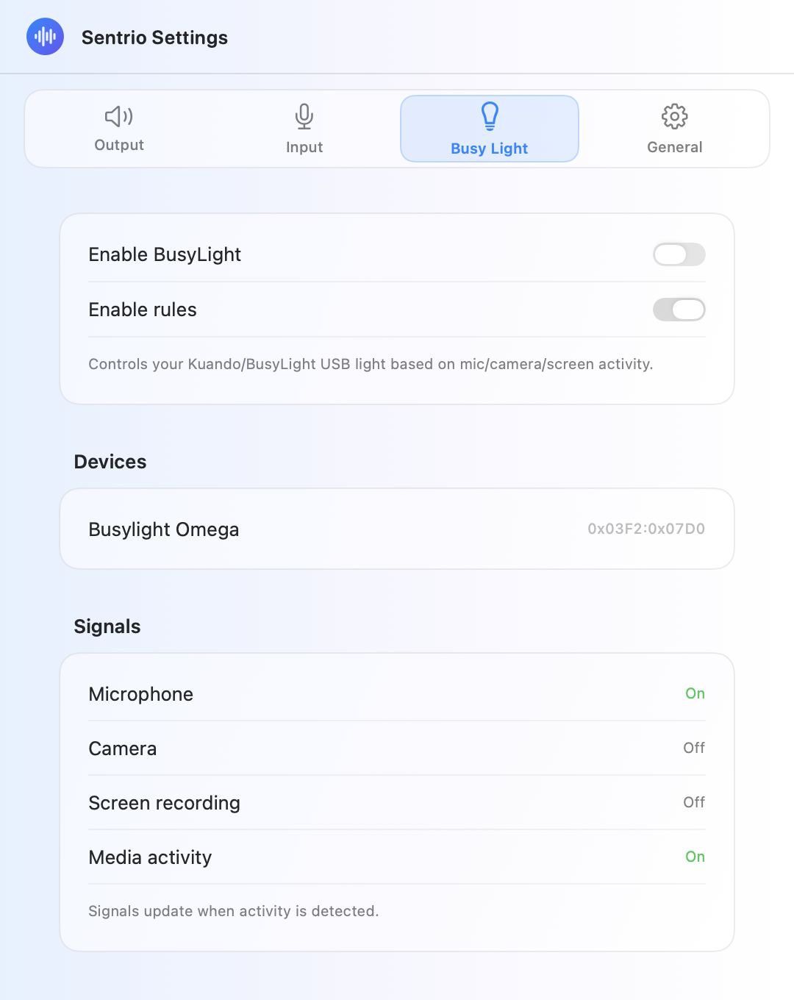
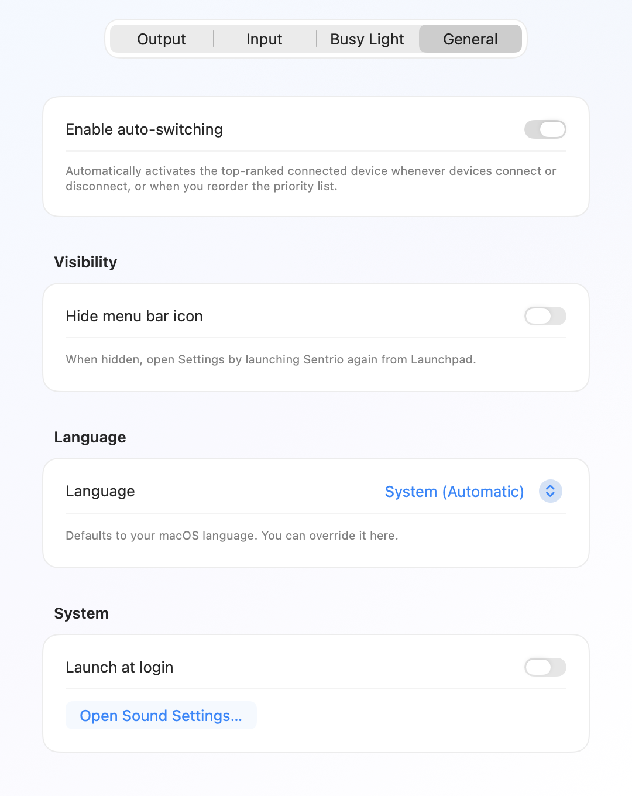

# Sentrio

A lightweight macOS menu bar app that keeps your audio routing and BusyLight behavior predictable.

[](https://github.com/YunaBraska/Sentrio/releases)
[](LICENSE)
[](https://developer.apple.com/macos/)

**[Product site](https://yunabraska.github.io/Sentrio/)** | **[User documentation](https://yunabraska.github.io/Sentrio/documentation.html)** | **[Install](https://yunabraska.github.io/Sentrio/install.html)**

---

## What Sentrio does

- Auto-switches output and input devices based on your priority order
- Uses explicit manual connect for Continuity/iPhone routes (shown as `Continuity` transport); failed manual connects fall back to next eligible priority
- Restores per-device output and input volumes. Direct builds also restore the macOS alert volume; App Store builds open macOS Sound for that system-owned setting.
- Supports custom device names and icons
- Shows battery info when macOS exposes it
- Adds BusyLight automation (rules/manual), HTTP control, and macOS integrations
- Runs a short BusyLight hello sequence on device detection, then applies rules/manual action
- Turns BusyLight off on app quit
- Shows per-rule BusyLight activity metrics (active total + rolling avg/day, avg/month, avg/year)
- Includes import/export for settings backup

## Install

### Download (recommended)
1. Open [Releases](https://github.com/YunaBraska/Sentrio/releases)
2. Download the latest DMG or zip (`Sentrio-<version>.dmg` or `.zip`)
3. Drag `Sentrio.app` into **Applications**
4. Direct releases are Developer-ID signed and notarized. Sentrio checks its signed update feed automatically and asks before installing an update.

### Homebrew
```bash
brew tap yunabraska/tap
brew install --cask sentrio
```

## Build from source

```bash
swift build
swift test
sh scripts/package.sh 0.0.1
open dist/Sentrio.app
```

To produce a local, ad-hoc signed App Store variant without releasing it:

```bash
SENTRIO_DISTRIBUTION=app-store sh scripts/package.sh 0.0.1
scripts/verify-app-store-bundle.sh dist-app-store/Sentrio.app
open dist-app-store/Sentrio.app
```

The argument is the three-component marketing version. Set `MACOS_BUILD_VERSION` to an independently increasing one-to-three-component numeric build version when needed. The submission package is produced only when Mac App Store application and installer signing identities are supplied.

Use [docs/app-store-review-notes.md](docs/app-store-review-notes.md) for reviewer context. Generate App Store Connect screenshots with:

```bash
sh scripts/generate-app-store-screenshots.sh
```

## Screenshots







## Regenerate Screenshots

```bash
bash scripts/generate-doc-screenshots.sh
```

## Contributing

See [CONTRIBUTING.md](CONTRIBUTING.md).

## License

MIT - see [LICENSE](LICENSE).
